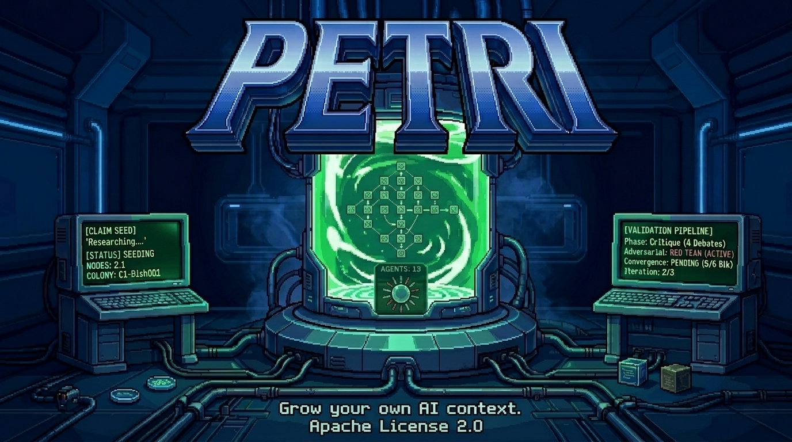

# Petri

[](https://pypi.org/project/petri-grow/)
[](https://pypi.org/project/petri-grow/)
[](https://github.com/onthemarkdata/petri/blob/main/LICENSE)
[](https://github.com/onthemarkdata/petri/actions/workflows/ci.yml)

An agent orchestration framework to grow your AI's context via Claude Code. Decomposes claims into DAGs of logical units and validates them bottom-up through a multi-agent adversarial review pipeline.

What results are a repository of curated information, citations, and URLs, organized by concepts, how they relate to each other, and the nuances of the claims. This is quite useful for AI agents to have pre-loaded context assets available for reference.

Petri includes both a CLI tool intended for AI agents and an interactive UI mode to help keep track of all active agents within Petri and to review the context, reasoning, and citations curated by the AI agents.

> **📖 [Read the Petri Vision →](VISION.md)** — where Petri is headed: durable, auditable, model-independent deep research you own and can reshape.

## Demo
https://github.com/user-attachments/assets/ef47dc07-741d-4ac5-9f35-2afb12fc9046

## ⚠️ Cost Warning ⚠️

**Hosted inference costs money regardless of the selected backend.** Each cell goes through 13 agents across multiple iterations. A colony with 10+ cells can generate thousands of calls across decomposition, research, critique, debate, red team, and evaluation.

With **pi**, charges follow its configured provider or subscription. **Claude Code** follows your Claude Code account and plan. A direct **provider** backend uses that provider's API credentials and billing. Local models avoid hosted API charges but still require suitable hardware and runtime resources. Start with a small claim and monitor usage before running a large colony. The dashboard shows measured token and cost totals; missing usage or prices appear as n/a. See [Observability](docs/observability.md).

## Choosing an inference backend

The v2 harness block in `.petri/defaults/petri.yaml` selects inference independently of agent content. Fresh dishes select pi. Existing dishes without a harness block retain the legacy Claude Code provider path.

For pi, use an exact model ID and provider name recognized by your pi installation:

```yaml
model: anthropic:claude-sonnet-4-6
harness:
  backend: pi
  model: claude-sonnet-4-6
  provider: anthropic
  tools: []
```

For the Claude Code adapter:

```yaml
model: anthropic:claude-sonnet-4-6
harness:
  backend: claude-code
  model: claude-sonnet-4-6
  tools: [Read, WebSearch, WebFetch]
```

For a direct Pydantic AI provider, supply its provider-qualified model string. Petri passes this string through unchanged:

```yaml
model: anthropic:claude-sonnet-4-6
harness:
  backend: provider
  model: anthropic:claude-sonnet-4-6
```

`harness.model` overrides the top-level model. If omitted, CLI adapters split the top-level `provider:model` string; explicit harness model IDs remain unchanged. `harness.tools` grants tools belonging to the selected CLI. Empty lists disable those tools. Pi's built-in coding tools do not include Claude Code's `WebSearch` or `WebFetch`.

The initial pi and Claude Code adapters support prompted structured output and validation retries. They reject Pydantic AI function-tool declarations and unsupported model settings; they do not silently discard them. Domain tools such as `search_cells` require a separate bridge before these adapters can run those agents. Direct provider models support the tools exposed by Pydantic AI.

### Install pi and Node.js

The npm installation requires Node.js. Petri checks for **Node.js 22.19.0 or newer**, the floor selected by the RPC spike. Install Node from [nodejs.org](https://nodejs.org/en/download), then install the pi version exercised by the local adapter validation:

```bash
npm install -g @mariozechner/pi-coding-agent@0.73.1
node --version
pi --version
```

Configure your provider in pi before starting a research run. The adapter uses pi's provider configuration and authentication; installing the CLI does not authenticate a provider. `PETRI_PI_BIN` can point to a different pi executable. Petri neither installs Node nor changes your shell configuration. The checked installation path uses npm; standalone pi binaries have not been validated by Petri's preflight.

If Node cannot be installed, select `harness.backend: claude-code` and install [Claude Code](https://docs.anthropic.com/en/docs/claude-code), or use a direct provider backend. Run `petri inspect` from the dish directory to check Python and the selected CLI without making a model call. Outside a dish, it checks pi as the fresh-dish default. Provider credentials are not validated by this command.

## Setup

Petri needs **Python 3.11+** and an inference backend. Use a [uv](https://docs.astral.sh/uv/) environment for the Python package; install pi and Node separately for the default backend.

### 1. Install uv

```bash
curl -LsSf https://astral.sh/uv/install.sh | sh
```

### 2. Create and activate a Python 3.11+ virtual environment

```bash
uv venv --python 3.11 .venv
source .venv/bin/activate          # macOS / Linux
# .venv\Scripts\activate           # Windows PowerShell
```

Every command from here on assumes this venv is active. If you open a new shell, re-run the `source .venv/bin/activate` line.

### 3. Install petri-grow into the venv

```bash
uv pip install petri-grow
```

### 4. Install an inference backend

Follow [Install pi and Node.js](#install-pi-and-nodejs) for the default backend, or choose one of the alternatives above.

### 5. Verify the full prerequisite chain

```bash
petri inspect
```

This reports missing prerequisites and version mismatches without modifying your system or making an inference request.

## Quickstart

Petri has two modes. Start with **Interactive Mode** — it's the fastest path from zero to a running colony.

### Interactive Mode (recommended)

```bash
mkdir my-research && cd my-research
petri launch
```

`petri launch` auto-creates `.petri/` from defaults, opens the Petri Lab dashboard at http://127.0.0.1:8090, and walks you through dish setup, seeding, growing, and inspection in the browser. No other commands required.

### CLI Mode (AI-agent friendly)

Petri is designed to be AI agent first for UX. It's highly recommended to have a Claude Code session already started and pass this README file link (https://github.com/onthemarkdata/petri/blob/main/README.md) directly to Claude Code to set up.

```bash
# 1. Initialize a petri dish
mkdir my-research && cd my-research
petri init
# → Initialized petri dish 'my-research' at /path/to/my-research
#   Model: claude-sonnet-4-6

# 2. Seed a colony from a claim
petri seed "Open source models will catch up to current frontier models in the next 6 months."
# → Colony 'open-source-models' created with 6 nodes across 3 levels

# 3. Check status
petri check
# → Shows a table of all cells with status PENDING

# 4. Grow cells through the validation pipeline
petri grow
# → Processes every eligible cell bottom-up: Socratic → Research → Critique → Red Team → Evaluation

# 5. Feed new evidence (requires cells that have completed validation)
petri feed https://arxiv.org/abs/2026.12345
# → Ingests content, matches to relevant cells, flags for re-validation

# 6. Analyze
petri graph                 # text tree / DOT export
petri launch                # Live web dashboard on port 8090
petri scan --fix            # contradiction scanner
# → `graph` shows the colony DAG as text;
#   `launch` opens the full Petri Lab dashboard (Computer tab,
#   Lab overview, Colony DAG, Logs, Cell detail)

# 7. Stop
petri stop
# → Gracefully halts any active processing
```

See [ARCHITECTURE.md](ARCHITECTURE.md) for the full pipeline and state machine details.

Seed foundation colonies before claims that depend on them. With the typed
harness, decomposition searches earlier colonies in the dish and can reference a
specific existing premise instead of creating a duplicate. Existing colonies
are not retroactively linked. Search uses deterministic word overlap; it does
not establish that two claims are logically equivalent.

At seed approval, choose **Edit** to change the unapproved draft without another
model call. Petri opens YAML in `$EDITOR` (or `$VISUAL`); keep premise IDs, edit
text or relations, remove rows to drop premises, or set `is_atomic: true` with a
`bedrock_reason`. Without an editor, use `edit N <text>`, `drop N`,
`relation N <supports|limits|rebuts>`, or `atomic N <reason>`, then `done`.
Dropping a parent or marking it atomic also removes its descendants. Invalid
edits return to the editor before any draft rows change. Petri backs up the dish
and records the validated edit before applying it; `seed --resume --colony NAME`
recovers an interrupted edit. Approved colonies cannot be edited through seed.

## CLI Reference

```
petri --help
```

| Command | Description | Key Flags |
|---------|-------------|-----------|
| `petri init` | Create `.petri/` directory with defaults (interactive setup wizard) | `--name`, `--no-questions` |
| `petri seed <claim>` | Decompose a claim into a colony DAG | `--no-questions`, `--colony` |
| `petri check` | Show cell statuses across colonies | `--colony`, `--cell`, `--json` |
| `petri grow` | Run cells through the validation pipeline (defaults to all eligible) | `--cell`, `--colony`, `--dry-run`, `--max-concurrent` |
| `petri feed <source>` | Ingest new evidence and flag affected cells | `--colony`, `--auto-reopen` |
| `petri graph` | Render the colony DAG as text tree or DOT | `--format`, `--colony` |
| `petri scan` | Run the contradiction scanner | `--fix`, `--loop` |
| `petri connect <a> <b>` | Inspect or create a dependency edge between two cells | |
| `petri launch` | Open the live web dashboard | `--port`, `--host` |
| `petri stop` | Gracefully halt active processing | `--force` |
| `petri inspect` | Check that all prerequisites are installed | |

**Typical workflow:**

1. `petri init` -- one-time setup
2. `petri seed "your claim"` -- decompose into a colony
3. `petri grow` -- validate bottom-up (leaf cells first, then parents)
4. `petri check` -- inspect progress
5. `petri feed <url>` -- add evidence, re-open affected cells
6. `petri grow` -- re-validate impacted cells
7. `petri graph` -- view the final colony structure

> **Note:** `petri grow` with no flags processes every currently eligible cell. For multi-level colonies, run it multiple times until all levels are resolved — leaf cells validate first, unlocking their parents. Scope to a subset with `--cell <id>` (repeatable) or `--colony <name>`.

## How It Works

Each cell in the colony goes through:

1. **Socratic questioning** -- Clarify terms, challenge assumptions, identify what evidence is needed
2. **Research phase** -- Investigator gathers evidence with URL-cited sources, Freshness Checker verifies currency, Dependency Auditor checks prerequisites
3. **Critique phase** -- Specialist agents assess in parallel, Cell Lead mediates structured debates
4. **Convergence check** -- All blocking verdicts must pass (mechanical check, no LLM)
5. **Circuit breaker** -- Max 3 iterations per cycle; if not converged, flags for human guidance
6. **Red Team** -- Dedicated adversarial phase builds the strongest case against the cell
7. **Evidence Evaluation** -- Neutral weighing of all evidence: VALIDATED, DISPROVEN, or DEFER

**Citation-first evidence model:** Every agent must back claims with URL-linked sources ranked by a 6-level hierarchy (direct measurement → community report). Summaries are kept terse to prevent context rot across iterations.

Every action is logged as an immutable event in the cell's JSONL file, identified by a composite key (`{dish}-{colony}-{level}-{seq}-{8hex}`).

## Observability

Traces and measured token and cost totals are available locally in `petri launch`.
No external service is required. See the [configuration and optional OTLP recipes](docs/observability.md).

## Architecture

- **Multi-agent pipeline**: lead orchestrators + specialists (blocking and advisory)
- **Event sourcing**: append-only JSONL per cell, rolled up to SQLite for the dashboard
- **Queue state machine**: enforced transitions, file-locked for concurrency
- **Claude Code native**: Petri runs on top of the Claude Code CLI as its agent harness — Claude Code is a hard dependency, not a pluggable option. The `adapters/` layer exists for internal separation of concerns, not to enable other harnesses.
- **Live dashboard**: single-file SPA with PTY-backed terminal, interactive colony DAG, and per-cell detail pages

See [ARCHITECTURE.md](ARCHITECTURE.md) for the full design, state machine diagram, and agent details.

## Development

```bash
uv pip install -e ".[all]"
uv run pytest tests/
```

## Decomposition evaluations

The default test suite includes deterministic decomposition evaluations with
FunctionModel and public synthetic fixtures. They run without network or
subprocess calls. Run the report directly with:

```sh
uv run python -m evals.decomposer
```

The seven evaluators check quota filling, count variation, counterarguments,
bedrock stops, specific cross-colony references, depth variation, and parent
restatements. Two historical failure shapes intentionally score poorly.
Reintroducing quota wording also fails an instruction regression check.

Private research stays outside this repository. To validate a local archive
bundle, set `PETRI_PRIVATE_ARCHIVE` and run the opt-in check:

```sh
PETRI_PRIVATE_ARCHIVE=/path/to/private-bundle uv run pytest tests/evals -m private_archive -q -s
```

The bundle contains `claims-graph.json`, `layer-distribution.json`,
`paired-waves.json`, and six documents under `principle-measurement/`. The
check prints aggregate counts and retrieval metrics. See the
[fixture provenance policy](evals/decomposer/fixtures/README.md).

Live evaluation calls the configured model and may incur provider charges. It
can run several dozen calls per case, with retries and tool calls adding more;
provider prices and actual token use determine cost. It never runs in CI or
falls back to another model. After choosing a model and accepting its cost, run:

```sh
PETRI_LIVE_EVALS=1 PETRI_EVAL_MODEL=provider:model uv run pytest tests/evals -m live -q -s
```

For a local endpoint, configure its provider environment explicitly and use its
exact model name. The live test prints a per-case report and fails if the
reference case does not reuse a specific non-root cell. Passing synthetic
fixtures does not establish that a live model makes reliable decomposition
judgments.

## Contributing

Petri is mid-flight on its **v2 migration** — re-platforming onto Pydantic AI, pydantic-graph,
and DBOS while staying zero-infrastructure. The roadmap lives in
[docs/v2/MIGRATION_PLAN.md](docs/v2/MIGRATION_PLAN.md), broken into milestone epics with scoped,
claimable issues — including
[good first issues](https://github.com/onthemarkdata/petri/issues?q=is%3Aissue+is%3Aopen+label%3A%22good+first+issue%22)
that need no prior context. See [CONTRIBUTING.md](CONTRIBUTING.md) for the branch model
(`dev` for PRs, `main` for releases), setup, and how to claim an issue.

## Credit
- Image Credits: Gemini Pro, April 2026
- Music by [Karl Casey @ White Bat Audio](https://youtu.be/o9C-4Gln9Tc?si=7Hi3_ouxqvgd28eR)

### Typed agent configuration

Inside a dish with v2 agent content, inspect and validate the roster before a run:

```sh
petri agents list
petri agents list --json
petri agents check
petri agents check --config path/to/petri.yaml
```

Both commands are cost-neutral: they construct no inference models and make no
LLM calls. `check` exits 0 for valid content, 1 for configuration violations, and
3 when no `.petri/` dish exists. Errors name the offending YAML fields. The v2
loader requires `schema_version: 2`; it does not silently convert v0.3.x content.
See [the schema contract](docs/ARCHITECTURE-V2.md#v2-agent-content-schema).

Run one specialist with the typed output schema and configured usage limits:

```bash
petri agents run skeptic --claim "A falsifiable claim" --yes
petri agents run evidence_evaluator --cell CELL_ID --verbose
petri agents run skeptic --claim "A claim" --model openai:MODEL_ID --max-requests 3 --max-tokens 12000
```

`--claim` and `--cell` are alternatives. `--model` overrides the selected agent's
provider model. `--max-requests` includes output retries; `--max-tokens` caps total
input and output tokens. Token limits are checked after a response, so a response
can cross the cap. A breached limit exits nonzero and prints the last unvalidated
model output with measured usage. Terminal evidence verdicts still require a
citation within the configured source hierarchy threshold.

An interactive terminal asks before inference because model use may incur costs.
`--yes` skips the warning; noninteractive runs skip it automatically. The usage
report prints provider-reported requests and input, output, and cache tokens. No
dollar estimate is shown for an unpriced model. `--verbose` includes output retries.

For a local model that follows JSON instructions more reliably than forced tool
calls, use `--output-mode prompted`; `tool` explicitly selects tool output. Both
modes enforce the same typed output and source validators. The live CLI test uses
[the pinned Docker Model Runner setup](docs/local-model-validation.md) and makes
real local requests only when enabled:

```bash
PETRI_LIVE_GEMMA=1 pytest -q tests/unit/test_cli_agents_run.py -m live
```

### Export derived research text

`petri export` writes deterministic per-cell Markdown and append-ordered
`events.jsonl` files under the dish's `exports/`, plus `edges.jsonl` and a format
manifest. Use `--colony <slug>` or `--cell <id>` to limit the scope. `--since <rowid>`
rewrites cells with later events; unchanged cell files retain their timestamps.
The database remains authoritative. Editing exported text does not change a dish.

`petri grow --export` exports after completion. Set `auto_export: true` in the
dish config for the same behavior on each run. `petri backup --with-export`
includes text generated from the snapshot itself, so its database and text agree.
