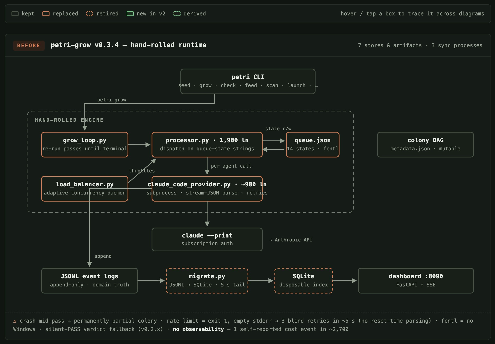

# Petri v2 Architecture

> The decision record and target architecture for the Petri v2 migration. This document is the
> single reference that migration issues cite — read it once and every issue's "why" is covered.
> The milestone roadmap and issue backlog live in
> [docs/v2/MIGRATION_PLAN.md](v2/MIGRATION_PLAN.md); the real-world evidence behind these
> decisions is indexed in [docs/field-reports.md](field-reports.md) (issues cite its entries as
> `#N` field-report numbers in code spans).

## Before / after at a glance

**Before** — `petri-grow` v0.3.4, the hand-rolled runtime (a 14-state fcntl-locked queue, an
adaptive load balancer, a subprocess stream parser, and a JSONL-plus-SQLite read path):



**After** — Petri v2, typed agents on a durable substrate (a typed pydantic-graph pipeline run as
durable DBOS workflows behind a swappable seam, one `petri.sqlite` per dish, OpenTelemetry
throughout):


## 1. The decision record (D1–D10)

Settled 2026-07-12 by the maintainer; issues must not re-litigate these.

| # | Decision | Key constraint |
|---|----------|----------------|
| D1 | Incremental strangler — CLI surface and `.petri/` layout stay; internals replaced subsystem-by-subsystem, shipping at every step | **Never require Docker or Postgres.** DBOS behind a swappable seam + Phase-0 spike |
| D2 | Durability: crash/interrupt resume, rate-limit-aware queueing, exactly-once LLM step recording, workflow observability | **OpenTelemetry is a first-class migration goal**, not an add-on |
| D3 | Inference: first-party pydantic-ai `Model` subclasses + any provider string in `petri.yaml` | Zero-API-key subscription auth stays possible |
| D4Δ | Storage (amended): one Petri-owned `petri.sqlite` per dish = domain truth (append-only `events` + `cells`/`edges` + `spans`/`usage` + views, stdlib sqlite3); DBOS SQLite = execution state only (separate file); `petri export` emits derived text for git/PR review | Events never edited or deleted — now schema-enforced; DuckDB dropped; `dashboard/migrate.py` and the combined-log rollup retire |
| D5 | Harness layer with **pi as default** (`--mode rpc`), Claude Code kept as adapter | pi is an optional runtime dependency, never a pip dependency |
| D6 | Agentic decomposer (search_cells tool, typed outputs, bedrock stop, counterarguments, per-parent caps) + `pydantic_evals` regression suite | Verdict-driven re-decomposition (#9) is a follow-on (M7) |
| D7 | OTLP export + trace view in the `petri launch` dashboard backed by the local `spans` table | Zero-infra default; DBOS Conductor/Console (proprietary) never bundled |
| D8 | No backward compatibility — v2 starts fresh | Old dishes stay on disk; reads tolerate their presence |
| D9 | Agent structure (enums, blocking semantics, debate protocol, pipeline) in typed code; content (instructions, vocabularies, pairings, models) in `petri.yaml` | "Configured, not hardcoded" survives with type safety |
| D10 | Milestones + small independently-landable issues + tracking epics + in-repo ARCHITECTURE-V2 doc | Label semantics defined once, in the doc |

## 2. What v2 preserves exactly (identity invariants)

- **Mechanical convergence** — all 6 blocking specialists' latest verdicts in their pass sets; a
  boolean check, no LLM judge — including weakest-link directives, short-circuits, and the
  3-iteration circuit breaker.
- **Append-only domain event sourcing** as the audit trail (the blog part-1 thesis) — now a
  schema-enforced `events` table (D4Δ), exportable as diffable text via `petri export`.
- **Composite cell keys** `{dish}-{colony}-{level}-{seq}` — which now double as deterministic DBOS
  workflow IDs, giving exactly-once cell processing for free.
- **Two-store separation** — domain truth (`petri.sqlite`) vs execution state (was `queue.json`,
  becomes the DBOS system DB in its own file); nothing crosses the boundary.
- **The 13-agent roster** (3 non-blocking leads + 10 specialists, 6 blocking) and the 4 debate
  pairings. (The shipped `petri.yaml` has a 14th entry, `socratic_questioner` — disposition is
  settled: it becomes a pre-pipeline utility outside the roster enum.)
- **The colony DAG as runtime data** (`graph/colony.py` — cycle detection, Kahn validation, BFS
  levels, bottom-up eligibility). pydantic-graph models only the fixed per-cell pipeline shape.
- **The constitution** as governance, with leads re-reading it per iteration (the documented
  drift-prevention pattern).
- **The CLI surface** (all 11 commands) and zero-infrastructure single-machine operation.
- **The micro-orchestrator identity**: v2 adopts substrate (typed model calls, checkpointed
  execution), not someone else's workflow abstraction. The workflow remains Petri's own.

## 3. Target architecture

### New packages

| Package | Purpose |
|---|---|
| `petri/harness/` | Harness abstraction (D5): pydantic-ai `Model` subclasses speaking CLI/RPC protocols — `PiModel` (default, `--mode rpc`), `ClaudeCodeModel`, provider-string passthrough; typed error taxonomy (`RateLimitedError.retry_after_seconds`, `AuthExpiredError`), shared retry policy (disable-able to avoid double-retry under DBOS) |
| `petri/execution/` | The durability seam (D1): a thin `ExecutionBackend` interface over DBOS-on-SQLite — durable workflows/steps, queues (concurrency, limiter), cancellation, fork, recovery. Swappable if the spike fails |
| `petri/pipeline/` | The per-cell validation pipeline as pydantic-graph typed nodes (Socratic → Research → Critique/Debates → Convergence → RedTeam → Evaluate), replacing the 14-state queue machine |
| `petri/agents/` | The agent factory (D9): builds 13 pydantic-ai Agents from typed structure + YAML content; debates as message-history hand-offs with shared usage + `UsageLimits`; eager config validation at startup |
| `petri/observability/` | OTel throughout (D2/D7): OTLP export + local `spans`/`usage` tables in petri.sqlite (age-pruned); domain attributes (dish/colony/cell, agent role, verdict, tokens/cost) |
| `petri/query/` | The read path (D4Δ): SQL views + typed query functions over petri.sqlite — convergence reads, validator reads, dashboard, analytics. Stdlib sqlite3; no DuckDB |
| `petri/evals/` | `pydantic_evals` decomposition-quality suite (D6): quota detection, bedrock stops, counterargument presence, restatement-children detection, cross-colony edge precision/recall |

### Module fates (current → v2)

| Current module | Fate | Target / rationale |
|---|---|---|
| `models.py` | Rewritten | Domain half (Cell, Event, typed payloads, composite keys) ports; `QueueState`/`QueueEntry` retire with the queue; `is_atomic` + `bedrock_reason` + typed claim-relation added to cells |
| `config.py` | Rewritten | Validated config object passed explicitly; import-time constants, `lru_cache` loader, and silent packaged-default fallback all retire (root cause of field issue #2) |
| `cli/*`, `cli_ui.py` | Kept | Same Typer commands — the strangler seam; internals rewired to the new engine |
| `engine/processor.py` | Replaced | → `petri/pipeline/` (pydantic-graph nodes) executed under `petri/execution/` |
| `engine/grow_loop.py` | Replaced | → DBOS queue draining + a colony orchestrator workflow that loops levels until no eligible cells remain (single-command full-colony growth) |
| `engine/propagation.py` | Wrapped | Pure DFS logic kept; flag-don't-auto-requeue human gate preserved |
| `engine/load_balancer.py` | Replaced | → DBOS queue flow control (`worker_concurrency`, `limiter`) |
| `engine/preflight.py` | Kept | Extended: pi/Node detection, version-range check |
| `storage/event_log.py` | Rewritten | Remains the single write seam, now writing rows to the `events` table (append-only, UNIQUE deterministic IDs — idempotent by constraint); `rollup_to_combined` retires |
| `storage/queue.py` | Replaced | → DBOS system DB + pipeline graph. The fcntl lock, `VALID_TRANSITIONS`, and the Windows blocker all retire |
| `storage/paths.py` | Rewritten | Shrinks dramatically under D4Δ: the tree becomes `petri-dishes/<dish_id>/petri.sqlite` + `exports/` (#14); lossy `parse_cell_id` consolidated away |
| `analysis/convergence.py` | Kept | Pure functions, ported verbatim onto typed verdicts — identity feature |
| `analysis/validators.py` | Rewritten | Same source-hierarchy rules as pure policy + `@output_validator` (ModelRetry) |
| `analysis/scanner.py` | Rewritten (M7) | Most drift categories disappear when structure is typed; shrinks to config validation + event-log integrity |
| `reasoning/decomposer.py` | Rewritten | → agentic decomposer (M3): search_cells, typed results, bedrock stop, per-parent caps in code |
| `reasoning/debate.py` | Rewritten | v1 "debates" are format-only stubs; v2 runs real multi-turn exchanges (M2) |
| `reasoning/ingest.py` | Wrapped | Kept; network I/O becomes DBOS steps; failure sentinels become typed errors (M7) |
| `reasoning/claude_code_provider.py` | Replaced | → `petri/harness/` Model subclasses; prompt builders extracted first (M1) |
| `graph/colony.py` | Kept | Runtime-data DAG (in-memory ops unchanged); persistence moves to the `cells`/`edges` tables, `dependents` becomes a view; gains integrity hardening in M6 |
| `dashboard/api.py` | Rewritten | FastAPI+SSE shell kept; reads → petri.sqlite via `petri/query/`; `/api/queue` → ExecutionBackend; `/api/proc` PTY bridge → workflow start/cancel/status |
| `dashboard/migrate.py` | Retired | The dashboard reads the domain store directly — no index rebuild |
| `dashboard/frontend.py` + `templates/frontend.html` | Kept | Field-hardened UI; gains the trace waterfall (M5) |
| `adapters/*` | Replaced | → `petri/harness/` backends; the generated-markdown-config approach retires |
| `templates/*.txt` | Retired | Prompt content moves to YAML instructions + typed agents |
| `defaults/` (petri.yaml, constitution.md) | Kept | The user-facing contract; schema updated to the D9 split |

## 4. Label semantics

Labels on migration issues carry defined meanings:

- **`breaking-change`** — the change observably alters behavior for existing users (CLI output,
  file formats, defaults). Absence means existing dishes and workflows behave identically.
- **`spike`** — a timeboxed investigation. The deliverable is a written document
  (`docs/spikes/...`) with go/no-go findings, not production code.
- **`rfc`** — design-first: the issue expects discussion and a written proposal before
  implementation starts.
- **`good first issue`** — newcomer-safe: self-contained, requires no context beyond the linked
  docs, and does not touch convergence semantics, the harness RPC protocol, or DBOS internals.
- **`size:S` / `size:M` / `size:L`** — rough effort estimate (hours / a day or two / several days).
- **Area labels** (`harness`, `agents`, `decomposer`, `durable-execution`, `observability`,
  `storage`, `dashboard`, `lifecycle`) — the subsystem the issue touches.
- **`epic`** — a milestone tracking issue; its sub-issues are the milestone's work.
- **`migration-v2`** — every issue in this migration backlog.

## 5. ADR index

Architecture Decision Records append here as the migration makes further decisions.

| ADR | Title | Status |
|-----|-------|--------|
| ADR-0001 | Storage: single Petri-owned `petri.sqlite` per dish (the D4 amendment) — replaces the earlier JSONL-files-plus-DuckDB read-layer design; text becomes a derived `petri export` artifact | Accepted — full write-up pending (tracked by the M1 "Finalize docs/ARCHITECTURE-V2.md" issue) |

## Typed roster and temporary legacy defaults

`petri.agents.contract` defines the ordered 13-agent roster: three non-blocking
leads, six blocking specialists, one conditional specialist, and three advisory
specialists. `socratic_questioner` lives under `pre_pipeline` in the shipped YAML;
it remains a clarifying-question utility outside `AgentName`. Its original
instruction and verdict vocabulary are preserved. Each roster member has a
verdict enum and explicit pass/block tuples.

During the migration, `defaults/legacy-petri.yaml` preserves the v0.3.x content.
The legacy config loader, convergence/debate default loaders, and v1 init select
that file. Existing dish filenames remain `defaults/petri.yaml`. The filename
change in the convergence loader is necessary because its unchanged tests expect
14 entries while v2 requires 13; convergence decisions and `AgentRole` are
unchanged. Legacy test fixtures explicitly copy the legacy file to the dish's
normal filename. The final v2 CLI switch must initialize from the current v2
`petri.yaml` and use the selected v2 harness instead of this temporary path.

## V2 agent-content schema

The v2 loader is `petri.agents.config.load_agent_config(path)`. Callers must pass
an explicit path and retain the returned `AgentConfig`; there is no fallback,
module-level loaded config, or cache. Missing files raise `AgentConfigError`.
The shipped file declares `schema_version: 2`. A v0.3.x dish configuration fails
validation; v2 does not silently migrate it (D8).

| Status | Configuration | V2 representation |
| --- | --- | --- |
| Stays in YAML | Instructions; pass/block verdict lists | `agents.<name>` content; verdicts must remain in the code-defined partition |
| Stays in YAML | Default model, tools, iteration cap | `model` string, `agent_tools`, `max_iterations` |
| Stays in YAML | Source hierarchy | Six typed levels and the terminal eligibility threshold |
| Stays in YAML | Debate participants and purpose | Typed roster references; whole/half rounds accepted at the boundary |
| Moves to code | Agent membership, display name, lead flag, phase, blocking, scope, redirect | `AgentName` and frozen `AgentSpec`; these keys are rejected in content |
| Moves to code | Meaning of fractional debate rounds | Programmatic debate protocol; YAML supplies the configured value |
| New in YAML | Per-agent model override | Optional `agents.<name>.model` |
| New in YAML | Usage caps | `limits.run` and `limits.debate`, convertible with `usage_kwargs()` |
| New in YAML | Harness selection | `harness` mapping with backend, optional model/provider, and tools |
| Relocated | Socratic utility content | `pre_pipeline.socratic_questioner`, outside the roster |

The default cell-run caps are 25 requests, 200,000 tokens and 10 tool calls.
Debates have caps of 6 requests and 50,000 tokens. These are configuration values
for the execution layer to enforce; loading a configuration does not itself
limit inference. Defaults use the pi harness. No inference occurs during loading.

Users can select a subset of an agent's existing verdict vocabulary, but cannot
invent verdict strings or move a verdict between pass and block partitions.
Blocking and conditional agents must retain a nonempty block vocabulary.
Duplicate YAML keys, duplicate verdicts, unknown roster names, missing agents,
unknown content fields and invalid debate participants are errors. Importing agent modules
loads no YAML configuration and creates no inference models. Decomposer-specific settings
remain outside this schema until the decomposer milestone adds them explicitly.

### Agent factory decisions

`build_agents` takes validated content and explicit constitution text. It validates
all content again before resolving any model, then builds uniquely named agents
with constitution text in pydantic-ai `instructions`. Instructions are supplied on
each run, including runs that reuse message history. `run_agent` supplies the
configured cell-run `UsageLimits`; callers of raw `Agent.run` must supply limits
explicitly. Configuration and inference models can be injected for offline tests.

The simplifier's `OVERCOMPLICATED` verdict is legal advisory vocabulary. It never
blocks convergence because the simplifier's code-defined mode is NON_BLOCKING.
This preserves the existing behavior in both contract and factory validation.

The installed API verified for this migration is pydantic-ai 2.64.0. The factory
uses ToolOutput for direct provider models and PromptedOutput for pi and Claude
Code transports. Both delivery modes pass FunctionModel tests; tool output also
passed a separate real local Gemma readiness check. A real CLI-harness factory
run remains an integration gate until the M1 transports are integrated. Callers
can explicitly select either mode for a tested backend. Validation retries are
bounded; invalid verdicts are reflected to the model and never coerced to a
passing value. In 2.64.0, tool-output retries are represented by a ToolReturnPart
with `outcome='retried'`, rather than always by RetryPromptPart.

Fractional YAML rounds normalize through `DebateContent.protocol`: `1.5` becomes
two first-participant turns, with the final partial exchange ending after that
participant speaks. Agent phases
and blocking semantics come solely from `AgentSpec`; the v2 content loader
rejects legacy numeric phase and structural fields instead of duplicating them.

### Source validation and exhausted retries

V2 citations require a syntactically valid HTTP(S) URL. This blocks missing or
malformed URLs during typed output validation; syntax validation does not prove
that a page exists or supports a claim. Retrieval and source verification remain
separate research responsibilities.

The evidence evaluator applies a pure source-hierarchy policy to
`EVIDENCE_CONFIRMS` and `EVIDENCE_REFUTES`. Its strongest level is the smallest
supplied level, and it must meet the configured `minimum_terminal_level`.
`EVIDENCE_INCONCLUSIVE` may contain no sources. Invalid outputs produce model
reflection and consume the configured output-retry allowance.

The exhaustion policy is to fail the run, preserving the distinction between an
inference failure and inconclusive evidence. The supported `run_agent` entrypoint
raises `AgentRunError` with the agent identity, diagnostic detail and
`EXECUTION_ERROR` marker; it never converts failure into a research verdict.
Callers record that marker in the domain event log and treat it as nonconvergent.
The output validator is attached to the agent itself; execution callers use
`run_agent` to receive the typed failure and enforce configured usage limits.

### Deterministic mechanical convergence

`petri.agents.convergence` evaluates typed roster facts without YAML reads or LLM
calls. The latest nonempty verdict per agent wins; leads do not vote. Missing
blocking verdicts outrank failing verdicts. Conditional triage redirects only
when its block verdict matches and every other blocking agent passes.
`CANNOT_DETERMINE` follows the same rule for `needs_experiment`. Short-circuit
checks consume a precomputed convergence result.

Weakest-link ties now follow `AgentName` definition order. This replaces YAML
insertion order without changing pass/fail criteria. An `EXECUTION_ERROR` record
is a present, failing verdict and can never satisfy convergence. The execution
layer is responsible for appending that failure to the domain event log; this
pure evaluator does not write events. Circuit-breaker counting remains relative
to the current cycle: `iteration - cycle_start_iteration >= max_iterations`.

### Real debate hand-off

A `DebateProtocol.rounds` value counts the first participant's scheduled turns.
YAML `1.5` normalizes to `rounds=2, final_word=pair[0]`, producing A, B, A;
YAML `1` produces A, B. The final partial round contains only `final_word`.
This makes the fractional-round behavior explicit without adding an LLM mediator.

`run_debate` passes each completed run's actual messages to the next participant
and accepts retained history from an earlier iteration. All turns share one
RunUsage and the configured per-debate limits. A budget or output-validation
failure returns a typed status, completed exchanges, attempted message history,
and measured usage. `log_debate` appends through the SQLite event-log seam using
the standard event envelope; the summary preserves turn output and usage.

### D7 instrumentation decision: native Pydantic AI OpenTelemetry

The instrumentation spike for #65 tested the locked Pydantic AI 2.64.0 runtime
with OpenTelemetry SDK 1.45.2. Use the first-party
`Agent.instrument_all(InstrumentationSettings(tracer_provider=provider))` entry
point. Pass Petri's shared provider explicitly. Disable prompt, completion, binary,
and model-request-parameter capture; token usage and span relationships remain
available. No Logfire account, token, SDK configuration, or cloud exporter is
required for this mechanism.

Both evaluated paths emitted one agent-run span, two model-request spans, and one
tool-call span to an in-memory exporter. Each model and tool span had the agent
span as its parent. The model reported 12 input and 5 output tokens in total.

| Path | Configuration | SDK import | Connection attempts |
|---|---|---|---|
| Chosen native OTel | `InstrumentationSettings(tracer_provider=provider)` | Logfire import blocked for the probe | 0 |
| Logfire alternative | `logfire.configure(local=True, send_to_logfire=False, console=False, metrics=False, additional_span_processors=[processor])`, then local `instrument_pydantic_ai()` | Logfire imported | 0 |

The native experiment blocks `logfire` imports before importing Pydantic AI;
its optional installed Pydantic plugin warns and is skipped. Both experiments
reject socket connections, clear inherited telemetry export settings within the
probe process, and use only an in-memory exporter. The Logfire alternative works
without sending to Logfire, but adds no required capability for Petri. Production
wiring therefore uses the native mechanism. The current broad `pydantic-ai`
distribution includes Logfire as a transitive extra, pinned by `uv.lock`; this ADR
adds no direct Logfire dependency or separate pin. Installed and configured are
different states: Petri does not call `logfire.configure()`.

The observed attributes are:

| Span | Operation | Token attributes |
|---|---|---|
| Agent run | `gen_ai.operation.name=invoke_agent` | `gen_ai.aggregated_usage.input_tokens`, `gen_ai.aggregated_usage.output_tokens` |
| Model request | `gen_ai.operation.name=chat` | `gen_ai.usage.input_tokens`, `gen_ai.usage.output_tokens` |
| Tool call | `gen_ai.operation.name=execute_tool` | None; tool spans carry `gen_ai.tool.name` |

Keep aggregate usage on the agent span distinct from request usage to avoid
counting the same tokens twice. This decision uses the default instrumentation
format version 5 in Pydantic AI 2.64.0; it does not assume the older 2.9.0 API.

Reproduce the two offline experiments with:

```bash
uv run python scripts/spikes/agent_instrumentation.py native
uv run python scripts/spikes/agent_instrumentation.py logfire
uv run pytest tests/unit/test_instrumentation_spike.py
```

Captured results are in [instrumentation-native.json](validation/instrumentation-native.json)
and [instrumentation-logfire.json](validation/instrumentation-logfire.json). This
spike verifies agent/model/tool spans and usage. DBOS parenting and Petri domain
attributes are implemented and tested separately in #67 and #68.

The #67 implementation lives in `petri.telemetry.instrument_agents` and is called
by CLI inference bootstrap after provider initialization. It configures all
factory agents and later-created Pydantic AI agents through one shared default;
changing the active dish/provider installs new settings. It uses `Agent.run()`
and does not depend on streaming.

`tests/integration/test_dbos_agent_spans.py` verified Pydantic AI 2.64.0 inside an
actual async DBOS 3.4.0 step: the agent span's parent ID equals the DBOS step span
ID, and reported token usage survives. The test uses SQLite, an in-memory span
exporter, and a socket connection guard (zero attempts). DBOS obtains its tracer
from OpenTelemetry's global provider, so the isolated test process installs the
same provider globally. Production DBOS wiring belongs to #66 and must connect
that global tracer to Petri's active provider. In DBOS 3.4.0, `enable_otlp=False`
disables span creation as well as export; recording locally requires it enabled
with empty exporter endpoints. No Logfire endpoint is configured.

### D7 domain attributes and command roots

`petri.telemetry.attributes` owns the typed attribute keys and deterministic
attribute maps. `CellSpanContext` takes the explicit dish ID, full colony ID,
level, and sequence; its cell key comes from `build_cell_key`. It never guesses
the dish boundary by splitting a hyphenated ID. Setter helpers apply these maps
to the supplied span. They do not read configuration, write events, or import DBOS.

| Attribute | Type | Present when |
|---|---|---|
| `petri.command` | string | Root command: `seed`, `grow`, `scan`, `feed`, or `re-decompose` |
| `petri.dish_id` | string | Command roots and cell/phase spans |
| `petri.colony_id` | string | Cell context is supplied; full composite colony ID |
| `petri.cell_id` | string | Cell context is supplied; `build_cell_key` output |
| `petri.level` | integer | Cell context is supplied |
| `petri.seq` | integer | Cell context is supplied |
| `petri.phase` | string | A phase span is open |
| `petri.agent_role` | string | A specialist is supplied; canonical `AgentName` |
| `petri.agent_blocking` | boolean | A specialist is supplied; true for blocking and conditional roles |
| `petri.verdict` | string | A validated verdict or mechanical convergence result is available |
| `petri.iteration` | integer | A phase span is open; dispatcher-owned iteration |
| `petri.weakest_link` | string | A weakest link is known |
| `petri.tokens_input` | integer | RunUsage includes measured token usage |
| `petri.tokens_output` | integer | RunUsage includes measured token usage |
| `petri.cost_usd` | number | All requests have measured usage and the exact model has configured prices |
| `petri.outcome` | string | A mechanical pipeline outcome is available |

A dish can supply `prices` keyed by exact model ID, with
`input_per_million` and `output_per_million` in USD. Cost is the sum of each rate
multiplied by its measured token count, divided by one million. These rates do
not model cache discounts or other provider billing rules. Missing prices or
usage omit cost; an explicit zero rate remains a configured zero cost. Partial
usage can report measured token totals, but omits cost when any request was
unmeasured. A dry run has no inferred token or cost attributes.

The pi RPC adapter supports usage: it sums assistant `usage.input`, `output`,
`cacheRead`, and `cacheWrite` across the request; input totals include cache
reads and writes. It marks missing usage with `unmeasured_requests`, which the
domain helpers preserve by omitting unknown totals and incomplete costs. The
source of these fields is the harness response, never the agent's assessment.

`phase_span` and `set_verdict_attributes` supply phase/agent hooks without coupling
research code to DBOS. Workflow code must apply `set_cell_attributes` through the
execution seam. `root_command_span` supplies the same command identity for
lifecycle operations; the existing seed/grow/scan/feed commands use the
`traced_command` wrapper. Re-decomposition (#84–#88) must use
`root_command_span("re-decompose", dish_id)` when its command is added. These hooks
preserve the distinction between execution spans and domain events.
