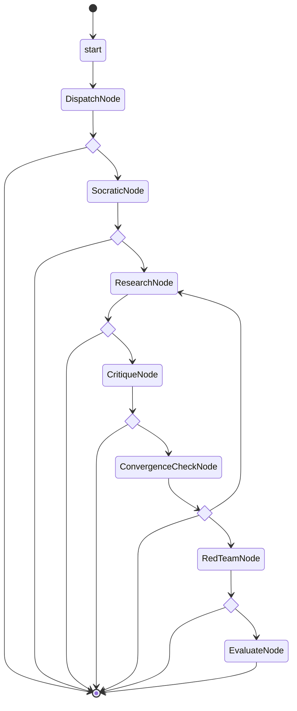

# Cell pipeline lifecycle

The typed pipeline in [`petri/execution/pipeline.py`](../petri/execution/pipeline.py)
models one cell's research round. Its injected callables have no default model,
event writer, or database connection. The CLI still selects the v1 execution
adapter; this graph supplies the control flow for the durable backend work.
The colony dependency DAG remains separate data in `petri/graph/colony.py`.

## Every v1 state has a disposition

| V1 queue state | V2 disposition | Rationale |
| --- | --- | --- |
| `queued` | `DispatchNode` | Checks synchronization before entering `SocraticNode`. |
| `socratic_active` | `SocraticNode` | Completes the Socratic phase before research; a failed phase can park for human review. |
| `research_active` | `ResearchNode` | Runs research and can only continue to critique or park for human review. |
| `critique_active` | `CritiqueNode` | Runs critique before the convergence decision or parks for human review. |
| `mediating` | `ConvergenceCheckNode` | Routes the four convergence outcomes to red team, another research pass, or an End. |
| `converged` | Obsolete: direct routing in `ConvergenceCheckNode` | No separate checkpoint-only node is needed between a convergence decision and red team or deferral. |
| `stalled` | Obsolete: `End[NeedsHuman]` | A failed or exhausted round parks immediately; restarting it is a new round. |
| `needs_human` | `End[NeedsHuman]` | Carries a reason for human intervention and performs no automatic retry. |
| `red_team_active` | `RedTeamNode` | Continues to evaluation or an open deferral. |
| `evaluating` | `EvaluateNode` | Produces one of four typed evaluation results. |
| `done` | `End[Validated]` or `End[Disproven]` | Separates confirmed and refuted claims that v1 stored under the same queue state. |
| `deferred_open` | `End[DeferOpen]` | Ends this round while allowing a later round after new evidence or input. |
| `deferred_closed` | `End[DeferClosed]` | Ends the lifecycle without an automatic re-entry path. |
| `sync_conflict` | `End[SyncConflict]` | Parks a conflict found by the dispatch guard, with a reason for the user. |

V1 can assign `sync_conflict` outside `VALID_TRANSITIONS`. The graph makes that
bypass explicit at dispatch. `NeedsHuman` and `SyncConflict` are different
payload types; each requires a nonempty human-readable reason. They end a round
and retain the reason for a caller to display. They are not polling nodes.

V1's `done -> queued` and `deferred_open -> queued` re-entry moves to admission
of a **new-round workflow** in the durable backend. The same boundary admits a
human-approved restart from `needs_human`, `stalled`, or `sync_conflict`. A
completed graph does not jump back into itself. The caller must allocate the
new round identity and restore the appropriate cycle state; implementing that
admission boundary is part of the backend work. `deferred_closed` has no re-entry
edge.

## Typed edges and the iteration clock

Each `BaseNode.run` return annotation lists its permitted next nodes and End
payloads. `ConvergenceCheckNode` returns exactly `RedTeamNode | ResearchNode |
End[ConvergenceEnd]`. `EvaluateNode` returns an End carrying `Validated`,
`Disproven`, `DeferOpen`, or `DeferClosed`. Research cannot skip critique.

Use `run_pipeline(state, deps)` to execute the graph. It derives its transition
guard from those annotations and checks both next nodes and terminal payloads.
A regression test found that Pydantic Graph 2.64 can route a node outside its
declared edges when Python code violates the return annotation; Petri's runner
rejects that transition before executing the destination phase. Calling the raw
`pipeline_graph.run()` bypasses Petri's guard and iteration clock.

Only the runner advances `state.iteration`, once when convergence returns to
research. Research, critique, and convergence within a pass see the same value.
The retry carries `weakest_link` and `focused_directive`; `cycle_start_iteration`
stays unchanged. Phase callables receive frozen snapshots, and normal assignment
to the live iteration field is rejected. These are Python API invariants, not
isolation from code that deliberately bypasses Python's attribute machinery.

Pydantic Graph 2.64 assembles `BaseNode` classes with `GraphBuilder`; its public
`Graph` no longer accepts the old `nodes=` constructor. We retain `BaseNode`
classes for typed transitions and use the builder for assembly and the entry
step. The [upstream graph documentation](https://pydantic.dev/docs/ai/graph/graph/)
describes this API and its Mermaid renderer.

## Generated diagram

This diagram comes from `pipeline_graph.render()`. It shows the shared graph
end marker; the mapping table and return annotations distinguish each payload.
The standalone generated copy is [`pipeline-graph.mmd`](pipeline-graph.mmd).

<!-- BEGIN GENERATED PIPELINE -->

<!-- END GENERATED PIPELINE -->

Regenerate both copies with:

```sh
uv run python -m tests.generate_pipeline_diagram
```

`tests/unit/test_pipeline_diagram.py` regenerates the text in memory and compares
both committed copies. Any graph or library change that alters the rendering
requires a reviewed diagram update.

## Execution state and domain state

The v2 storage boundary uses two databases per dish: `dbos.sqlite` holds workflow
status, scheduling, step checkpoints, and recovery state; `petri.sqlite` holds
cells, dependency edges, and append-only domain events. The graph does not write
to either database. Backend and phase adapters supply those operations.

A successful execution checkpoint avoids repeating a completed step. A crash
after an external side effect but before its checkpoint can repeat that side
effect. Domain event IDs make repeated event insertion idempotent; they cannot
guarantee exactly-once model billing. The
[DBOS SQLite spike ADR](adr/ADR-M4-dbos-sqlite-spike.md) requires one execution
owner per dish and an application admission/rate boundary because the measured
multi-process queue limits were exceeded.
